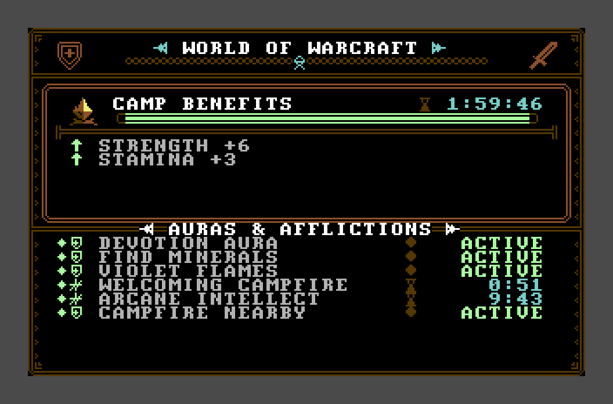

# WoW Forever — C64 Status Effects

A Lua addon and .NET 10 console companion that display WoW Forever buffs, debuffs, and Camp Benefits on a physical Commodore 64 Ultimate. A custom 2 KB RAM charset provides readable fantasy lettering, ornamental frames, campfire/shield/sword/skull icons, and progress bars in standard 40×25 character mode. The CPU stays paused; no bitmap mode, resident C64 program, or raster effects are used. Character name, level, XP, and location are not collected or transmitted.



[Charset mapping, exported art, and hardware instructions](docs/charset.md).

The connection is one-way: addon APIs → a tiny visible pixel stream → Windows screen capture → C64 REST memory writes. No game input, process-memory reads, injection, or secret-value bypasses are used. The C64 CPU stays paused while the VIC-II displays screen-memory updates.

**Experimental hobby project — your mileage may vary (YMMV).** Use at your own risk. Read the [disclaimer](#disclaimer) before using real hardware or a game account. The project is released under [the Unlicense](LICENSE.md): do what you will, including commercial use, modification, and redistribution.

## Run

Requires Windows 11 for live capture, the [.NET 10 SDK](https://dotnet.microsoft.com/download/dotnet/10.0) (the runtime alone cannot build this source), a WoW Forever client with addons enabled, and a C64 Ultimate with its REST API reachable on your trusted local network. Other WoW editions, C64 devices, and firmware versions are not verified. Offline previews need only the SDK and this source.

Download/extract the source or clone the repository, open PowerShell, and change to the directory containing `WowForever.C64.slnx`. Then:

1. Check `dotnet --version` reports an installed 10.0 SDK and build:

   ```powershell
   dotnet build WowForever.C64.slnx --configuration Release
   ```

2. Install the addon. The script tries the Blizzard registry entry; if it cannot find your client, pass the path to the `_forever_` folder containing `Wow.exe` and `Interface`:

   ```powershell
   .\scripts\Install-Addon.ps1
   # Explicit-path alternative (replace this example with your installation):
   .\scripts\Install-Addon.ps1 -WowPath 'C:\Games\World of Warcraft\_forever_'
   ```

   Alternatively, copy `addon\WowForeverC64` into your client's `Interface\AddOns` directory so `WowForeverC64.toc` sits directly inside `Interface\AddOns\WowForeverC64`. Enable **WoW Forever C64** in the game's AddOns list. Restart the game if a new addon is not discovered; use `/reload` after updating an existing installation. Run the installer again after source edits.

3. On the C64, enable **Web Remote Control** in **Network Services & Timezone** and note its IP address. Close the Ultimate menu and start at normal C64 BASIC with I/O mapped in. Save any work first: `send` and `watch` overwrite dashboard RAM and display registers and leave the CPU paused.

4. Create your own settings file, then edit its `host` value to the C64's address. **`192.168.1.64` is an example; replace it if your device uses another address.** `c64.local.json` is ignored by Git. Configure the optional network password as described under [Settings](#settings).

   ```powershell
   Copy-Item c64.example.json c64.local.json
   notepad c64.local.json
   dotnet run --project src/WowForever.C64.Console -c Release -- status --config c64.local.json
   ```

   Wait for `ONLINE` before continuing. `status` checks connectivity without changing C64 memory.

5. Log into Forever, use windowed or borderless mode, and enable `/c64 bridge on`. Start the companion, then return WoW to the foreground and keep its bottom-left corner unobstructed:

   ```powershell
   dotnet run --project src/WowForever.C64.Console -c Release -- watch --config c64.local.json
   ```

   Allow a few seconds for a complete snapshot. The terminal can stay in the background. If packets are rejected, try `/c64 bridge 3` and see [Troubleshooting](#troubleshooting).

`watch` checks REST, pauses the CPU, uploads the custom charset (default `$2000`), selects its VIC bank and text-mode pointers, and updates the cells. No BASIC loop or C64 program is needed. Configured display RAM is dedicated to the dashboard.

The visible pixel patch is **128×10 physical pixels**, eight pixels from the bottom-left edges, below chat. It sends compact binary chunks at five frames per second using calibrated grayscale levels for HDR compatibility. `/c64 bridge 3` uses larger cells (**192×15**) if capture is unreliable; `/c64 bridge 2` restores the default. `/c64 bridge off` hides it, and `/c64 bridge on` restores it. Cell size is saved; the bridge starts enabled on login/reload.

Ctrl+C stops the companion and leaves the C64 CPU paused. Reset the C64 to return to ordinary BASIC use. Opening/closing the Ultimate menu may release the pause; the next dashboard update reasserts it.

To uninstall, stop the companion, remove `Interface\AddOns\WowForeverC64` from the game client, and reset the C64. The addon does not need a service or background installation.

## Screens, resolutions, and scaling

The design is independent of a specific PC resolution or aspect ratio. The addon recalculates its scale from the physical screen height and effective game UI scale, keeping cells at two or three physical pixels. Windows capture uses the foreground WoW window's client position with thread DPI awareness, rather than hardcoded desktop coordinates. It searches the bottom-left region (up to 768×384 pixels), so a different screen resolution should not need code changes.

| Setup | Expected behavior and limits |
| --- | --- |
| 1080p, 1440p, 4K, ultrawide, or a resized window | Designed to work if the complete patch remains visible at integer pixel sizes. These are expected configurations, not a tested resolution matrix. |
| Windows display scaling or game UI scale changes | The addon compensates for UI scale and the capture uses physical coordinates. Fractional resampling or graphics effects can still make cells unreadable. |
| Multiple monitors | Capture follows the foreground WoW window, including desktop positions outside the primary monitor. Mixed-DPI/HDR monitor moves and windows spanning screens are unverified; keep WoW fully on one screen and reload/restart if capture stops. |
| HDR | The grayscale bridge was previously verified on one HDR setup (30/30 decoded packets). Other displays, color filters, gamma settings, and brightness clipping may prevent decoding. Try larger cells, disable color filters, or try SDR if needed. |
| Minimized, covered, off-screen, or background WoW | Requires the visible patch in foreground WoW. Timers freeze when the stream becomes stale. Exclusive fullscreen and remote/streamed desktops are unverified; use windowed/borderless mode. |
| C64 monitor or TV | The dashboard stays at 40×25 characters regardless of PC resolution. Use a screen and video mode that already show the C64's ordinary BASIC display correctly; the monitor/Ultimate handles scaling. This tool does not change the C64 video output resolution. |

The patch needs its full 128×10 pixels (or 192×15 with `/c64 bridge 3`) plus the eight-pixel left/bottom margins. Leave it in its default position and keep overlays clear of it. Check that the terminal reports `Receiving status stream` and the C64 updates after changing resolution, UI scale, or monitors. Compatibility beyond the reported setup remains YMMV; combat handling and harmful-effect acquisition also remain unverified in-game.

## Dashboard behavior

- Camp Benefits has a pinned feature panel, a campfire icon, an hourglass timer, and a duration bar. Its detail lines omit source labels and compact recognized game descriptions to bonuses such as `STRENGTH +6`, with green up-arrow tiles. Unrecognized wording remains readable without inventing values. General effects use green/red diamonds; harmful text and skulls stay red. `ACTIVE` values are green and timed values cyan. Stat names and amounts come from the game.
- Countdown timers use the game's readable expiration values. Permanent effects show `ACTIVE`. Stacks greater than one appear beside the effect name.
- Combat entry freezes the collected snapshot and shows `PAUSED - IN COMBAT`; timers show `FROZEN`. Collection resumes after combat. This behavior is implemented but has not yet been validated during actual gameplay.
- Missing heartbeats or an unreadable/hidden patch freeze the last display after three seconds. Returning to WoW restores the stream. A complete snapshot repeats periodically so late starts and dropped frames recover automatically.
- Long lists rotate every eight seconds, configured with `watch.pageSeconds`: nine general-aura rows and five Camp Benefits detail rows page independently while the panels and title stay fixed. There is no active-enchantments banner, page counter, connection footer, or effect-count footer. Critical notices replace the decorative header ribbon only when needed. C64 keyboard paging is not implemented.
- Small changes send only changed ranges of character/color RAM. Charset uploads are cached. A display-state probe every 15 seconds triggers repair only when needed. C64 transport failures are logged and retried every five seconds. A disconnected C64 cannot receive an on-screen connection warning until its network connection recovers.

## Preview without starting WoW

```powershell
dotnet run --project src/WowForever.C64.Console -c Release -- preview --snapshot samples/status-effects.json --output artifacts/fantasy-dashboard.png
```

The sample contains example out-of-combat effect values, without character identity or account information. It is not a live feed. The PNG draws the exact custom glyph bytes and cell colors; the console text view is only a diagnostic approximation. Export the glyph atlas or raw font with `charset --output artifacts/fantasy-atlas.png` or `charset --output artifacts/fantasy-charset.bin`.

To send that static sample to the hardware:

```powershell
dotnet run --project src/WowForever.C64.Console -c Release -- send --snapshot samples/status-effects.json --config c64.local.json
```

The original communication proof of concept is also available:

```powershell
dotnet run --project src/WowForever.C64.Console -c Release -- status --config c64.local.json
dotnet run --project src/WowForever.C64.Console -c Release -- send --message "HELLO C64!" --config c64.local.json
dotnet run --project src/WowForever.C64.Console -c Release -- preview --message "HELLO C64!"
```

## Settings

Edit [appsettings.json](appsettings.json) in the repository root. A normal build copies it beside the executable; publishing includes it too. The executable always loads the settings beside itself, regardless of your working directory. Run without `--no-build` after changing the source settings.

| Setting | Default | Meaning |
| --- | --- | --- |
| `host` | `192.168.1.64` | C64 IP/hostname or HTTP(S) origin with optional port. |
| `timeoutSeconds` | `5` | Timeout per REST request, 1–120 seconds. |
| `display.screenAddress` | `1024` (`$0400`) | 1 KB aligned screen RAM. |
| `display.charsetAddress` | `8192` (`$2000`) | 2 KB aligned charset RAM in the same VIC bank. |
| `display.charsetFile` | `null` | Optional 2 KB file using the documented mapping; otherwise generate the included artwork. |
| `watch.processName` | `Wow` | Foreground process name, without `.exe`. |
| `watch.pollMilliseconds` | `100` | Capture interval, 50–150 ms, faster than the 200 ms stream frame. |
| `watch.staleSeconds` | `3` | Missing-heartbeat limit before timers freeze. |
| `watch.pageSeconds` | `8` | Automatic display-page interval. |

`--host` overrides `C64_HOST`, which overrides JSON. `--config <path>` selects a replacement JSON file; explicit relative paths resolve from the current directory. Copy `c64.example.json` to the ignored `c64.local.json` if you prefer local settings. Unknown JSON properties are rejected.

If the Ultimate has a Network Password, set it in the same terminal before running the companion. In **PowerShell 7.1 or newer** (`pwsh`), use:

```powershell
$env:C64_PASSWORD = Read-Host 'Ultimate Network Password' -MaskInput
```

The password is sent as `X-Password`, read only from the environment, and not logged. Clear it with `Remove-Item Env:C64_PASSWORD` afterward. The device's ordinary HTTP service uses the trusted local network without encryption.

Keep credentials out of JSON files and command arguments. Local settings, `.env` files, private key files, build outputs, logs, and editor settings are ignored by Git; this does not sanitize files you deliberately force-add. Normal capture keeps pixels in memory without saving screenshots and sends decoded status data only to your configured C64. Addon SavedVariables and copied `/c64 report` diagnostics can contain effect details; review them before sharing.

Diagnostics go to stderr; previews go to stdout. Exit codes: `0` success, `1` transport/API failure, `2` configuration error, `130` Ctrl+C. `watch` keeps retrying network failures until cancelled.

## Troubleshooting

| Symptom | Action |
| --- | --- |
| Waiting for pixel packets | Load the updated addon, return WoW to the foreground, keep its bottom-left corner clear, and enable `/c64 bridge on`. |
| Patch visible but packets rejected | Install addon v0.5.0 or newer and `/reload`, then restart the companion so both use the grayscale protocol and bottom-left location. HDR can stay on. Try `/c64 bridge 3` and windowed/borderless mode. The companion identifies marker, brightness-level, header, and checksum failures; damaged packets are ignored. |
| Timers freeze when switching apps | Expected: foreground-only capture stops when WoW is no longer foreground. The companion can run in a background terminal. |
| Effects missing immediately after login/change | Allow the chunk burst to finish. Periodic full snapshots repair missed chunks. Check partial/truncated indicators. |
| C64 connection refused or timeout | Check the configured host, power, local network, and Web Remote Control service. |
| HTTP 403 | Match `C64_PASSWORD` to the device's Network Password. |
| HTTP 404 with `Could not read data from attachment` | Earlier builds used POST uploads, whose firmware attachment handler can stop working even while REST stays available. Restart the current companion: it uses 128-byte PUT writes to bypass that path without a power-cycle. |
| `SENT` but wrong glyphs/no display | Close the Ultimate menu, return to normal BASIC with I/O visible, and restart the companion so it uploads the charset again. Check custom charset files against the documented mapping. |
| Display gets overwritten | Close the Ultimate menu and allow another update, or rerun the command to pause again. |

## Source and verification

- [addon/WowForeverC64](addon/WowForeverC64): guarded acquisition, combat freeze, diagnostics, binary pixel encoder.
- `src/WowForever.C64.Core`: status model, stream decoder/reassembly, screen codes, colored dashboard, independent REST transport.
- `src/WowForever.C64.Console`: Windows capture, command/configuration handling, live loop and reconnects.
- [docs/bridge.md](docs/bridge.md): protocol, source research, policy review, and capture limits.
- [docs/charset.md](docs/charset.md): cell model, glyph allocation, RAM placement, VIC setup, previews, and manual verification.
- [addon/README.md](addon/README.md): installation and addon diagnostics.

Phase 1 screen writes were confirmed on the physical C64. A user report from Forever `1.60.1.70888` confirmed readable buffs and Camp Benefits tooltip lines, including Sharpening Wheel and First Aid Kit. Live capture of the bottom-left v3 grayscale bridge was verified with HDR enabled: 30 of 30 captured packets decoded, assembling a complete live five-effect snapshot. Combat handling and harmful-effect acquisition remain unverified in-game.

Release builds, Lua syntax, sample layouts, glyph export/loading, and local encoder/transport exercises were checked. The custom character-mode dashboard is now confirmed on the user's physical C64. No tests, test project, verification scripts, or third-party runtime libraries are included. Build with:

```powershell
dotnet build WowForever.C64.slnx --configuration Release
```

## Disclaimer

This is an experimental, unaffiliated hobby tool provided **AS IS**, **without warranty of any kind**. Your mileage may vary (YMMV). There is no promise of accuracy, completeness, reliability, fitness for a particular purpose, ongoing maintenance, or compatibility with any game build, addon policy, Windows/display configuration, C64 hardware, or firmware.

You use it at your own risk and are responsible for your setup, backups, and compliance with the terms and policies applicable to your game account and hardware. It writes C64 RAM and hardware registers, pauses the CPU, and can interrupt programs or overwrite unsaved data. Read-only game data export does not imply approval by a game operator or guarantee account safety. The project is not affiliated with or endorsed by Blizzard Entertainment, Commodore, or the Ultimate hardware/firmware authors. Third-party names and trademarks belong to their respective owners.

To the maximum extent permitted by applicable law, the authors and contributors disclaim all warranties and accept no liability for claims, faults, errors, data loss, interruption, account actions, hardware issues, or other damages arising from use of this tool. See [LICENSE.md](LICENSE.md) for the full public-domain dedication and warranty/liability disclaimer; it covers this project's original code and artwork, not third-party games, firmware, or trademarks.
